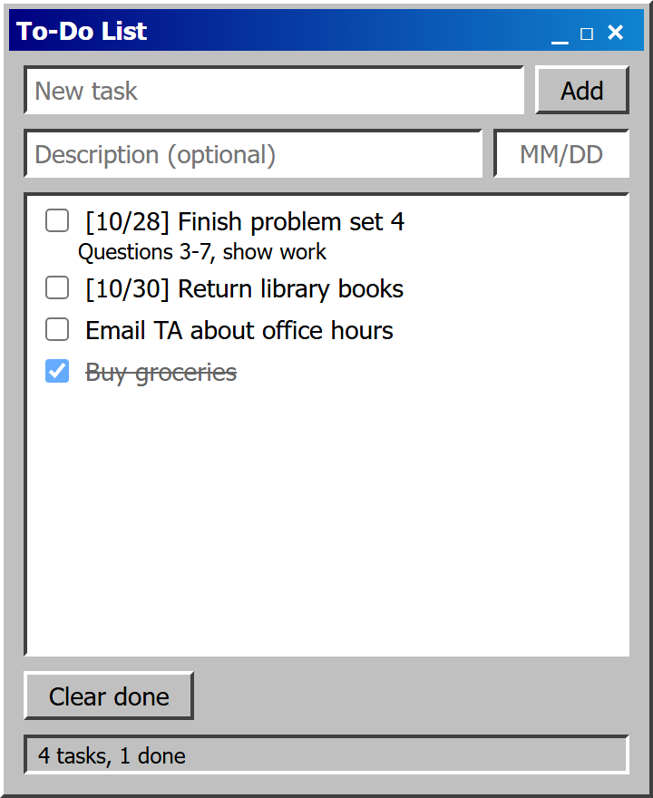
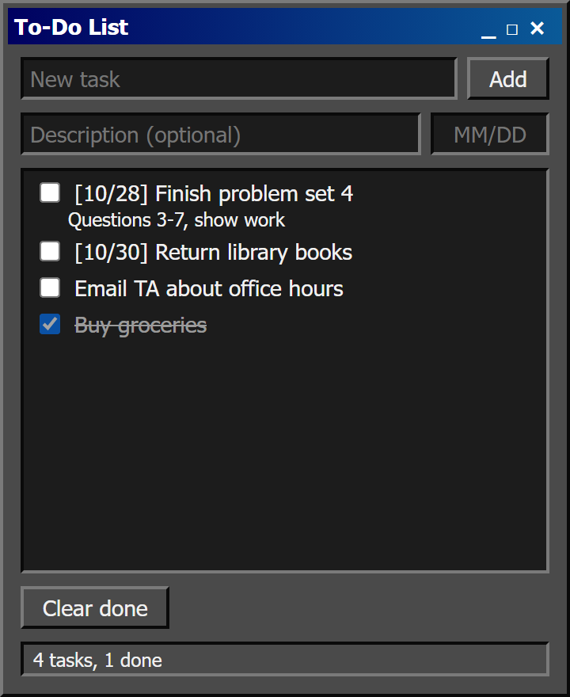

# To-Do List

A tiny to-do list in the style of early-2000s Windows apps: gray bevels, a navy title bar, and nothing you don't need.

  
  

## Features

- Add tasks with an optional description and `MM/DD` due date
- Check tasks off, then **Clear done** to remove them
- Saves automatically, so your list is still there after you close the app
- Working title bar: drag to move, `_` minimize, `□` maximize, `×` close
- Follows your Windows light/dark setting
- Pins to the taskbar like any other app

## Getting started

Needs Windows 10 or 11. Windows 11 already includes the [WebView2 runtime](https://developer.microsoft.com/en-us/microsoft-edge/webview2/) the app runs on; on Windows 10, install it from that page if the app doesn't open.

1. Double-click **`build.cmd`**. It downloads the WebView2 library and compiles `To-Do List.exe` with the C# compiler built into Windows. Nothing to install.
2. Double-click **`To-Do List.exe`**.
3. Right-click its taskbar icon and choose **Pin to taskbar**.

## Using it

- Type a task and press **Enter** (or click **Add**). Enter works from any of the three boxes.
- Type dates as `MM/DD`; the slash is added for you. Invalid dates are left off.
- Check a box to mark a task done. **Clear done** removes every checked task.

## Where your list is saved

Tasks are stored in the app's own browser storage under `%LOCALAPPDATA%\To-Do List`. Delete that folder to start over.

## How it works

| File | What it does |
| --- | --- |
| `To-Do List.html` | The app itself: layout, style, and logic |
| `app.cs` | A borderless window that shows the page and handles the title bar |
| `build.cmd` | Downloads WebView2 and compiles `app.cs` |
| `app.ico` | The taskbar icon |

The page runs in WebView2 (the Edge engine built into Windows) inside a frameless window. Edits to `To-Do List.html` show up the next time you open the app; only changes to `app.cs` need a rebuild.

Keep `To-Do List.exe`, the three `.dll` files, and `To-Do List.html` in the same folder. If you move them, pin the app again.

## License

[MIT](LICENSE)
